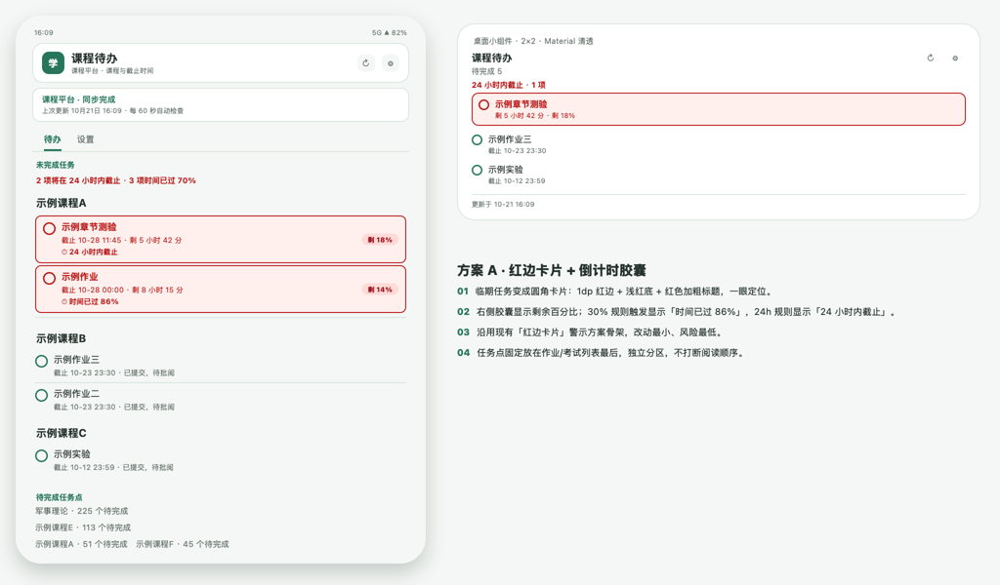
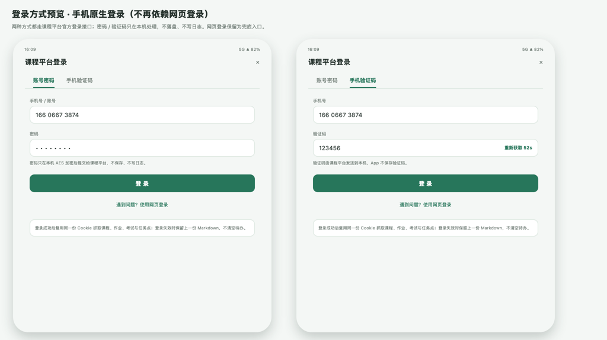
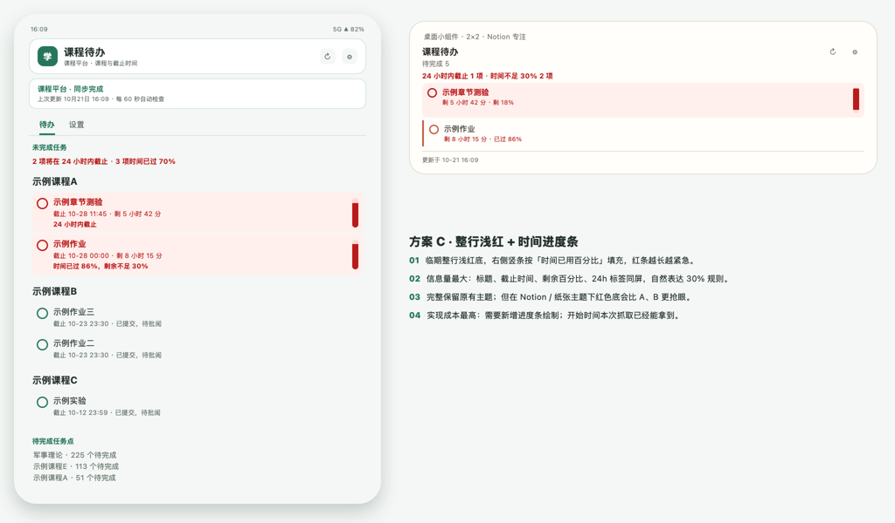
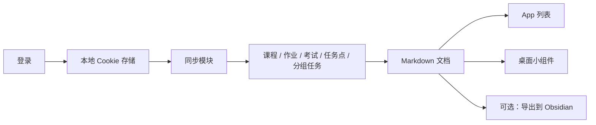

# 课程待办小组件

[](https://github.com/madmaks223/course-todo-widget/actions/workflows/check.yml)


一个 Android 桌面小组件：**兼容学习通（超星）**，把作业、考试、章节任务点和分组任务整理成本地待办清单，
不用每次登录网页逐个点开，就能看到最近要交什么。

> 个人非官方项目，与任何课程平台官方无关联。仅用于本人账号的课程提醒，
> 请遵守学校与平台的使用规定。

## 功能

- 登录方式：**网页登录**——账号密码 / 手机验证码 / 扫码都在平台网页内完成，App 不读取、不保存密码；登录页支持切换电脑版。
- 自动整理作业、考试、章节任务点、分组任务，写入本地 `课程待办.md`。
- 桌面小组件三套样式：Material 清透 / Notion 专注 / 纸张时间线。
- 截止提醒：距截止 24 小时内或时间已过 80% 时红色高亮，三种警示样式可换。
- 任务排序：按课程分组，或按截止日期由近到远；分组任务与“大作业”固定在底部。
- 常驻后台同步（轻量刷新 + 定时完整同步），支持开机恢复、电池白名单引导。
- 主题（浅色/深色/薄荷/纸张）、字体大小、隐藏已完成任务。
- 数据只在本机：可导出 Markdown 给 Obsidian，也可以直接分享。

## 兼容性

- 支持**学习通（超星）**账号登录（账号密码 / 手机验证码，网页登录兜底），读取本人账号的课程数据。
- 其他课程平台暂未适配。
- 首次安装展示演示数据；**登录成功后自动切换真实数据并隐藏演示入口**。
  未登录或演示状态下，App 与桌面小组件都会提示「登录学习通后显示真实待办」。
- 主题（浅色 / 深色 / 薄荷 / 纸张）可正常切换；小组件美化方案独立于 App 主题。

## 截图

| 红边卡片 · 倒计时胶囊 | 登录页 |
| --- | --- |
|  |  |

| 整行浅红 · 时间进度条 |
| --- |
|  |

> 截图使用脱敏演示数据渲染。

## 使用

### 环境

- JDK 17、Android SDK 34
- Android 8.0（API 26）及以上

### 构建

```bash
git clone https://github.com/madmaks223/course-todo-widget.git
cd course-todo-widget
./gradlew assembleDebug testDebugUnitTest lintDebug
```

APK 输出在 `app/build/outputs/apk/debug/app-debug.apk`。

### 开始使用

1. 安装 APK，打开 App，先看看演示数据和小组件样式（首次登录前才有演示入口）。
2. 设置 → 数据来源 → 登录学习通（在网页里完成登录后，点「完成登录」）。
3. 桌面长按 → 小组件 → 添加「课程待办」。
4. 设置 →「加入电池优化白名单」，让后台同步更稳。
5. 需要切换账号时，到设置最底部「账号 → 退出登录」（会二次确认，并清除本机登录状态）。
5. 需要的话，把 Markdown 导出到 Obsidian 指定文件，之后每次同步自动更新。

## 排序与提醒规则

设置 → 外观：

- **任务排序**
  - 按课程排序：课程分组，组内按截止时间；
  - 按截止日期排序：作业/考试平铺，截止近的在上，没有截止时间的排最后；
  - 分组任务和标题里含“大作业”的长期任务，两种排序下都固定在底部“分组任务 / 大作业”。
- **截止警示**
  - 柔和、红边卡片+倒计时胶囊、时间线、时间进度条，四种可选（设置页有实时效果预览）；
  - 红色触发条件：距截止 ≤24 小时，或已用时间超过总时长的 80%。
- **三个设置互相独立**
  - 主题只改变 App 配色，不影响桌面小组件；
  - 小组件美化方案只改变桌面小组件，不影响主题；
  - 截止警示方案同时作用于 App 列表和小组件。

## 数据流



同步分两级：常驻服务每 2 分钟做一次轻量刷新；完整刷新在手动刷新、App 打开超过 1 小时或登录后执行，
两次刷新之间用本地快照补齐绝对截止时间与任务点。请求失败或平台要求验证时会暂停自动同步并提示。

## 项目结构

```text
app/src/main/java/com/course/todo/
  core/       数据模型、页面解析、加密登录、Markdown 读写、截止规则、排序
  data/       Cookie 存储、HTTP 客户端、登录、数据读取
  storage/    原子写 Markdown、本地快照、设置
  sync/       WorkManager、常驻前台服务、同步执行、开机恢复
  ui/         待办列表、设置、登录页、主题
  widget/     RemoteViews 小组件与刷新
app/src/test/  解析器、截止规则、Markdown、排序、快照、登录跳转测试
docs/          界面预览图
```

## 测试与 CI

- CI：push / PR 自动执行 `assembleDebug testDebugUnitTest lintDebug`，并上传 debug APK。
- 本地：64 个 JVM 单元测试；lint 0 error。

### 本地真实页面回归（可选）

仓库不附带真实账号页面快照（含个人课程、作业信息，已 gitignore）。
想跑真实页面解析回归时，把页面快照放到 `app/src/test/resources/fixtures/`，相关测试会自动启用；
**不要把快照、Cookie 或任何个人数据提交到 Git**。

## 隐私与安全

- 不保存账号密码，不写日志；Cookie 只存本机 App 私有目录，退出登录即清空。
- 没有自建服务器、统计 SDK 或广告，所有数据只在本机。
- 仓库不包含真实账号数据或截图。
- 详见 [SECURITY.md](SECURITY.md)。

## 合规与使用边界

- 仅限本人账号，用于个人课程提醒；不提供批量账号、代查、代刷课、代写、代考能力。
- 不绕过验证码或访问限制：平台要求验证时暂停同步，由用户手动完成。
- 非商业用途；请勿将本项目用于违反学校规定或平台规则的行为。
- 第三方组件与许可见 [THIRD_PARTY_LICENSES.md](THIRD_PARTY_LICENSES.md)；
  App 内「设置 → 关于 → 开源许可」也可查看。

## 免责声明

- 数据来自平台网页端，平台页面或接口调整后可能失效，不保证长期可用。
- 自动化访问可能触发平台的访问限制，存在账号被限制的风险，使用前请自行判断。
- 使用本软件造成的一切后果由使用者自行承担。

## 参考资料

- 早期思路参考了 GitHub 上的社区项目 [xsk666/xxt_work_notice](https://github.com/xsk666/xxt_work_notice)。

## 许可

[MIT License](LICENSE) © 2026 madmaks223

版本记录见 [CHANGELOG.md](CHANGELOG.md)。
